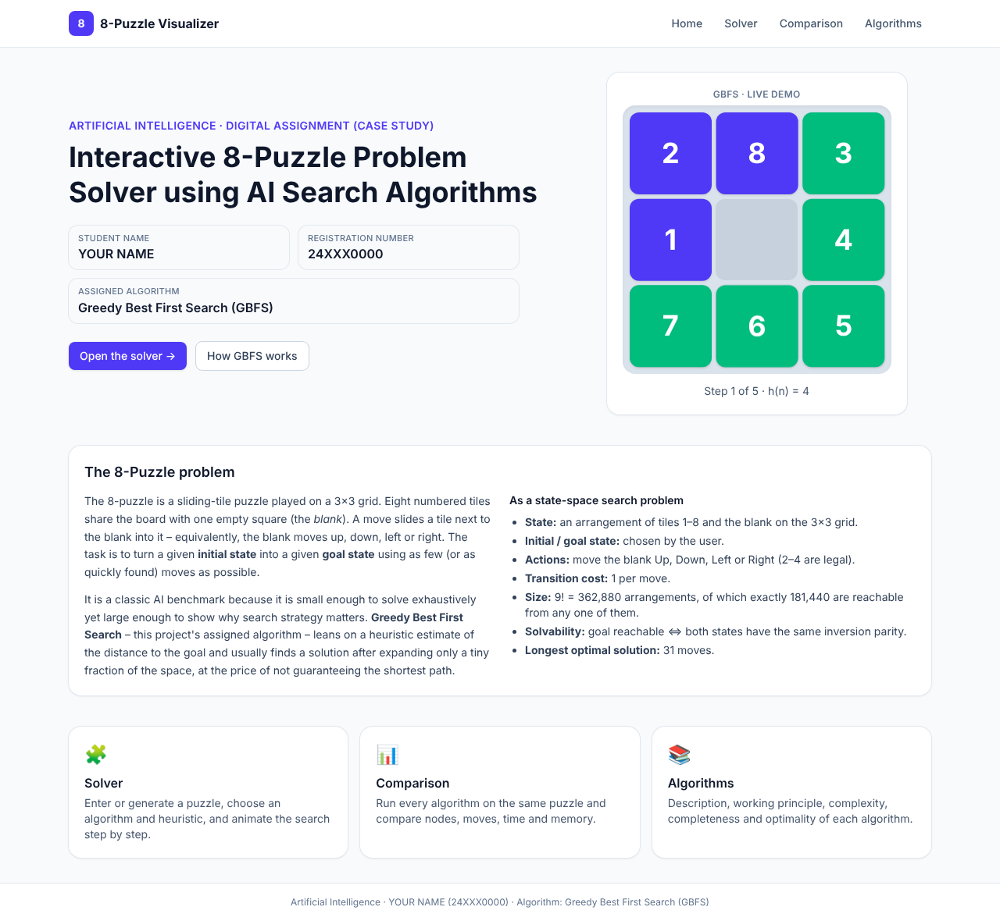
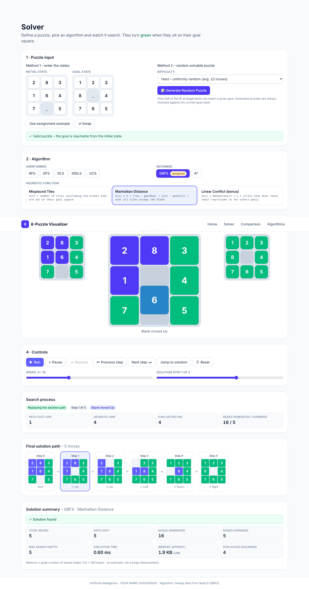
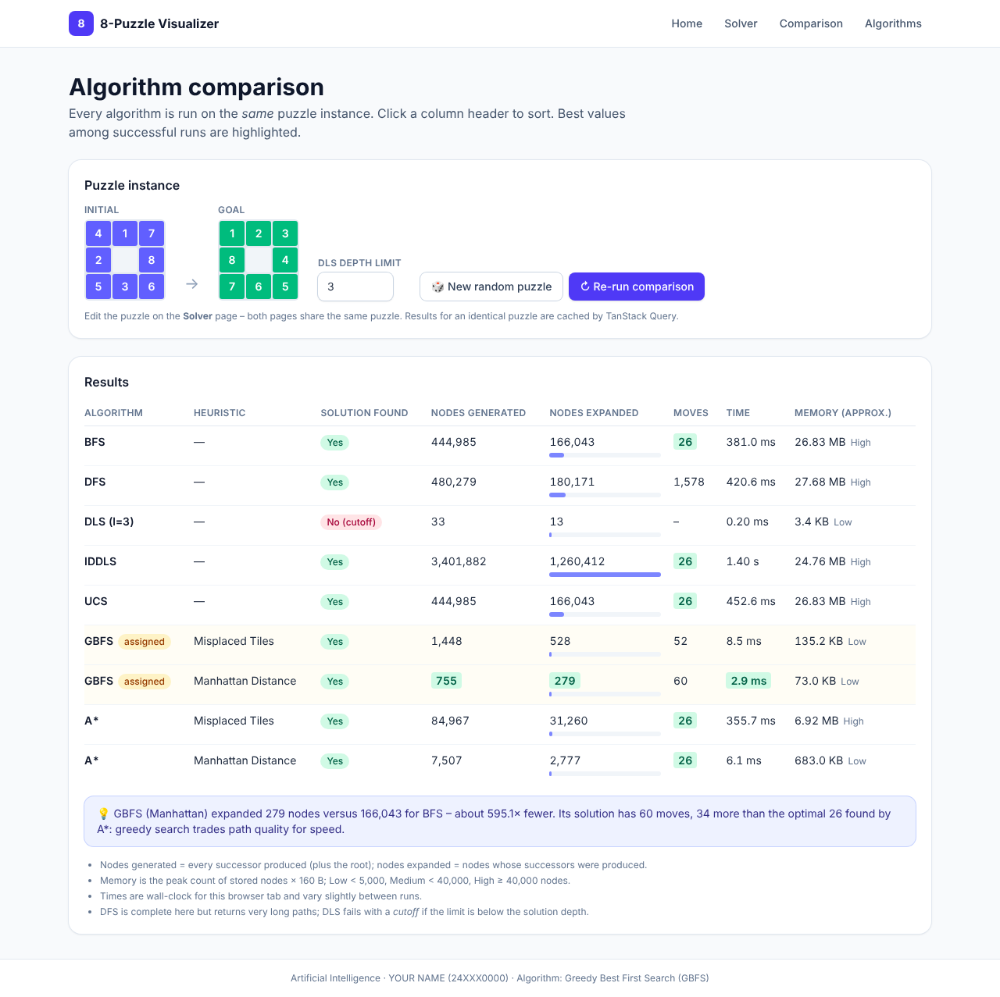
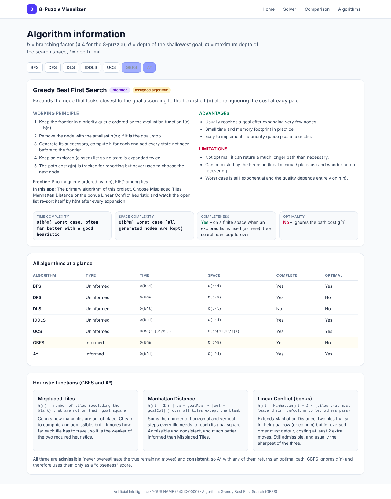

# AI 8-Puzzle Visualizer

Interactive web application that solves the **8-Puzzle** with state-space search algorithms and visualises, step by step, how the search proceeds.
Built for the *Artificial Intelligence* digital assignment (case study).

**Assigned algorithm: Algorithm 6 – Greedy Best First Search (GBFS)**, an informed search driven by the heuristic `h(n)`.

## Student details

| | |
|---|---|
| Name | Sivaseelan Sa |
| Registration number | 24BCE2526 |
| Course | Artificial Intelligence |
| Algorithm | 6 – Greedy Best First Search |

## Live demo

- GitHub repository: `https://github.com/siva2526/8Puzzle-Solver/`
- **GitHub Pages URL:** `https://siva2526.github.io/8Puzzle-Solver/`

## Project description

Pages (routing by TanStack Router, hash-based so deep links work on GitHub Pages):

| Page | Contents |
|---|---|
| **Home** | course, title, student name & registration number, introduction to the 8-puzzle, live GBFS demo, navigation |
| **Solver** | puzzle input (type both states **or** generate a random solvable puzzle), algorithm + heuristic selection, animated board, live search-process panel, solution path, solution summary, playback controls |
| **Comparison** | all algorithms on the same puzzle in a sortable table (nodes generated/expanded, moves, time, memory) |
| **Algorithms** | description, working principle, advantages, limitations, time/space complexity, completeness, optimality for each algorithm, plus the heuristics |

Visualisation: initial, goal and current state; the sliding animation of tiles into the blank; the node being expanded with its parent;
generated successors (added / discarded / improved); the frontier (open list) in selection order; the explored (closed) list; counters for generated/expanded nodes and depth;
g(n), h(n), f(n) for informed algorithms; and the final solution path. Controls: **Run, Pause, Resume, Next Step, Previous Step, Reset, Speed**, plus a scrubber and *Jump to solution*.

## Technologies used

- **Vue 3** + **TypeScript** (strict)
- **TanStack Router** (`@tanstack/vue-router`) – typed routes and search params
- **TanStack Query** (`@tanstack/vue-query`) – runs and caches the algorithm comparison
- **TanStack Table** (`@tanstack/vue-table` v9) – sortable comparison table
- **Tailwind CSS v4** – styling and responsive layout
- **Vite** (build) and **Vitest** (unit tests)
- Search algorithms, data structures (queue, stack, binary heap) and heuristics are implemented **from scratch** in `src/engine` – no search libraries.

## Search algorithms implemented

| # | Algorithm | Frontier |
|---|---|---|
| 1 | Breadth First Search | FIFO queue |
| 2 | Depth First Search | LIFO stack |
| 3 | Depth Limited Search (user-set limit) | LIFO stack |
| 4 | Iterative Deepening DLS | LIFO stack, limits 0…31 |
| 5 | Uniform Cost Search | priority queue on g(n) |
| **6** | **Greedy Best First Search (assigned)** | **priority queue on h(n), FIFO ties, explored list** |
| 7 | A* Search | priority queue on f(n) = g(n) + h(n) |

GBFS is the project's primary algorithm and gets the fullest treatment. The other algorithms are included because the assignment's selection and
comparison pages list all of them; the engine treats them identically (same successor order, same counting rules) so the comparison is fair.

Conventions: every move costs 1; goal test when a node is selected; successors generated in the order Up, Down, Left, Right (blank movement);
"generated" counts every successor produced plus the root, "expanded" counts nodes whose successors were produced; ties are broken first-in-first-out.
DLS/IDDLS re-queue a state only if reached at a shallower depth – this keeps the search finite on the cyclic state graph without losing solutions within the limit.

## Heuristics used

- **Misplaced Tiles** – number of non-blank tiles not on their goal square.
- **Manhattan Distance** – sum of horizontal + vertical distances of every tile to its goal square.
- **Linear Conflict** (bonus) – Manhattan + 2 for each tile that must leave its row/column to let reversed tiles pass.

All three are admissible and consistent. Solvability is checked with inversion parity, which works for any goal state; random puzzles are guaranteed solvable.

## Screenshots

| Home | Solver (GBFS) |
|---|---|
|  |  |

| Comparison | Algorithm information |
|---|---|
|  |  |

Mobile layout: `docs/screenshots/mobile.png`.

## How to run the project

Requires Node.js 20+.

```bash
npm install
npm run dev        # development server
npm test           # unit tests for the search engine
npm run build      # type-check + production build into dist/
npm run preview    # serve the production build
```

### Deploy to GitHub Pages

1. Create a repository named `AI-8Puzzle-Visualizer` and push this project to the `main` branch.
2. In **Settings → Pages**, set **Source = GitHub Actions**.
3. The workflow in `.github/workflows/deploy.yml` runs the tests, builds and publishes the site. The build uses relative asset paths and hash routing, so it works under `https://siva2526.github.io/8Puzzle-Solver/` without extra configuration.

## Repository structure

```
AI-8Puzzle-Visualizer/
├── index.html                # Vite entry
├── src/
│   ├── engine/               # puzzle model, heuristics, frontiers, search algorithms, tests
│   ├── stores/solver.ts      # shared state + playback logic
│   ├── components/           # board, inputs, selector, controls, search-process panel, summary
│   ├── pages/                # Home, Solver, Comparison, Algorithms
│   ├── router/               # TanStack Router setup
│   ├── config/               # student details, algorithm documentation
│   └── style.css             # Tailwind entry
├── public/                   # static assets (favicon)
├── docs/                     # screenshots
├── .github/workflows/        # GitHub Pages deployment
└── README.md
```

(The assignment's sample layout `css/`, `js/`, `assets/`, `images/` maps to `src/style.css`, `src/`, `public/` and `docs/screenshots/` because the project uses Vue + Vite as required.)

## References

- Russell, S. & Norvig, P., *Artificial Intelligence: A Modern Approach*, 4th ed. – search algorithms, heuristics, 8-puzzle.
- Johnson, W. W. & Story, W. E. (1879), "Notes on the 15 puzzle" – solvability by inversion parity.
- Korf, R. E. (1985), "Depth-first iterative-deepening", *Artificial Intelligence* 27 – IDDLS.
- Hansson, Mayer & Yung (1992), "Generating admissible heuristics by criticizing solutions to relaxed models" – Linear Conflict.
- Documentation: [Vue](https://vuejs.org), [TanStack Router/Query/Table](https://tanstack.com), [Tailwind CSS](https://tailwindcss.com), [Vite](https://vite.dev), [Vitest](https://vitest.dev).
- AI assistance: this project was generated with the help of Claude (Anthropic) and reviewed, tested and adapted by the student.
